# The Cutting Room - dev log

*By Yexl. A solo entry to the 2026 Epic AI MegaJam ("Director's Cut"), made by one person directing AI agents. Unreal Engine 5.9, C++.*

## What it is

The Cutting Room is a six-fight boss rush on a miniature film set standing on a director's desk. In each fight you pilot a different small machine against one big villain machine, and every boss asks one question (make it ram a pillar; find the real take among its doubles; drop the crane's load on it; hurt it only in the light; send its own gold shots back through its shield; recognise which earlier scene it is replaying).

The theme became the core button. Landing hits fills a strip of film; when it is full you shout **CUT**, the fight freezes, and the director's arm takes **one part off the boss**. Every part *is a scene* - a group of that boss's attacks - so the boss can no longer play it. You then either wear the part (the boss's attack becomes yours on E) or throw it in the scrap tray to heal, and the last boss replays the scenes you threw away. One of the three parts carries the fight's question: cut it and the question is gone. Our rule is that this must never be the fastest way through; at the last measurement (the submitted build) it held in fights 2, 4 and 5 by 7 to 22 %; fight 3's was not measured again after its last change.

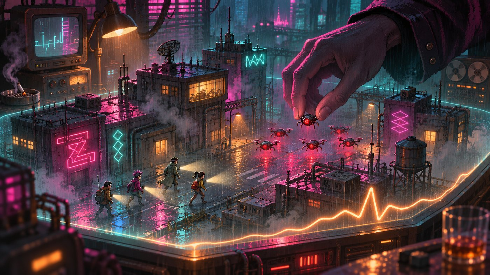
*Day 1 (12 Nov): one of the first AI-generated concept pictures. I picked this one, and "the player is the director's hand" came from it.*

## Who did what

I worked alone with AI agents. Claude Code was the lead: it held the plan, wrote the briefs, merged everything and kept a timestamped log of the decisions and of the notes I gave. For larger jobs the lead started sub-agents, each with a written brief and, from day 4 on, **its own copy of the project**, so that the main project always compiled and I could keep playing in the editor while they worked.

The agents wrote all the C++, built every model as a Blender script, synthesised all sound in Python, made the concept sheets with an image generator, play-tested without a window, and reviewed their own work in briefed roles (first-time player, combat designer, art director, effects lead, copy editor, QA).

I did not write code, model, or work inside the editor. I chose directions from pictures, played the builds with the editor's Play button, and wrote notes after the fights I played - usually a few lines. I wrote them in Chinese; where this log repeats them, it is in translation.

## The pipeline as it actually ran

**Pictures first.** Early on I told the lead that a grey-box prototype gives me no ideas: with a prototype I get no inspiration, I only feel that the idea could be extended. So every new direction began with concept pictures: 41 style pictures in two styles, nine art-direction sheets, 14 design sheets for the machines, their modules and the arm, and six "one boss, one question" fight pictures (70 in all). The machines are all mechanical on purpose: the lead could model hard-surface shapes precisely in Blender scripts, but not people.

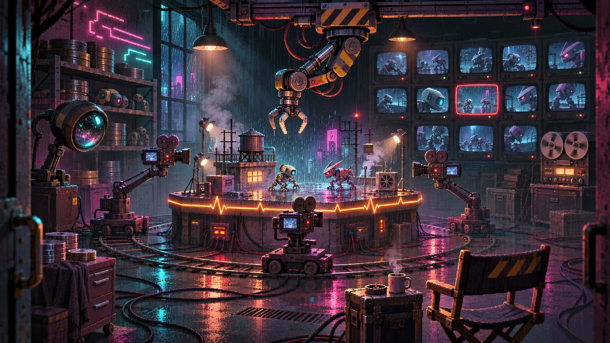
*Day 2: art-direction sheet a07; I assigned it to the title screen ("click and the camera pushes in to the table").*

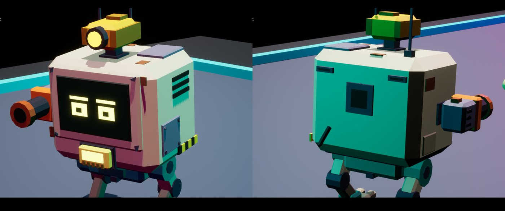
*Day 2, morning: an early scripted ROOKIE in the engine. The same day I asked for models "close to the concept art in detail".*

**Models as code.** Each machine is one Python file (`art/m_brute.py` and so on) built headless by Blender, so one sub-agent per machine could model in parallel. Sets, props and floors are scripts too.

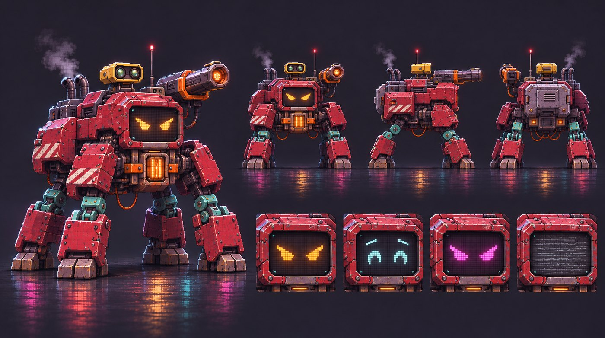
*Day 2: BRUTE's design sheet from the image generator, the reference its modelling script was written against.*

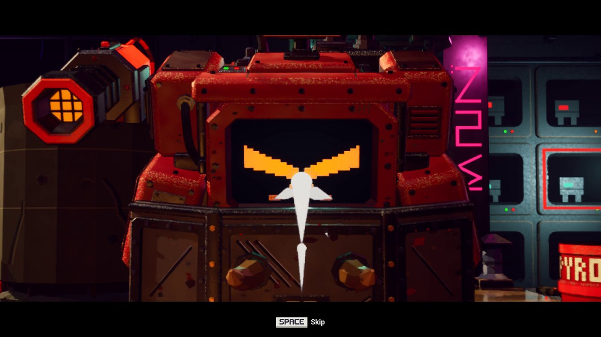
*The scripted BRUTE in the final build, in its entrance shot - after the redesign of day 4 gave it a horned ram plate in front and an engine on its back.*

**Sound as code.** Every effect and music track is synthesised in Python (numpy/scipy), mastered to loudness targets written down in `audio/mix.py`, and checked by recording the game's sound offline and measuring it - not by ear (see below).

**A game that agents can play.** `tools/play.ps1` starts the packaged game with no window, sound or real input; the agent plays by writing lines into a pipe file (key presses, pointer positions, `wait`, `until end`, `CRShot name` for a picture). Step play (`CRStep`) holds the fight still between commands so an agent can think, and `sheet.py` lays a stretch of play out as a contact sheet. Each game took about 3 GB of the 16 GB graphics card, so at most four ran at once.

**A stand-in player.** The game has a built-in bot with a reaction delay (`CRBotRun <takes> <reaction>`). Balance was measured as 24 takes at 0.3 s reaction, for the default order of play and for the "delete the question first" order, and the briefs gave their targets as numbers (e.g. "the default between 50 and 65 s and won at least 21 times in 24"). `tools/rushrun.ps1` has the stand-in play the whole game, then films the end reel and the end card - the integration check after merges. The simulation runs in fixed 1/60 s steps with seeded dice, so the end-of-game reel replays my real inputs exactly.

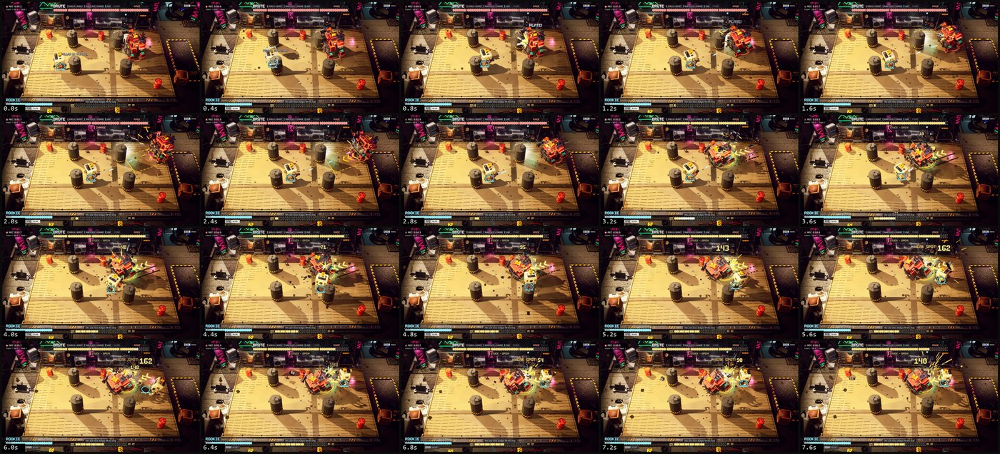
*The stand-in playing fight 1 in the final build, one frame every 0.4 s - a contact sheet, the form in which the lead "watched" most fights.*

**Jobs, snapshots, merges.** On the last evening seven jobs ran at once, each in `work\<job>proj`. A job handed over a built **snapshot**; the lead three-way merged it into main against the job's starting copy, backed main up first (29 backups so far), rebuilt, and checked the result in pictures.

## Turning points

**1. A puzzle film became a boss rush (days 1-2).** The first design was a puzzle: freeze the scene, move parts and AI chips between machines, and make the scene hit its script beats. I approved it, the agents built eight scenes in three acts - and then I played it with my own hands. My note: it is still boring; once I take the enemy's weapon or its legs, I am hitting a wooden post. Agent play-testers had found the same from the other side: one trick (disable the target) won every scene. We turned it into a boss rush where I play the hero; CUT survived as the link to the theme.

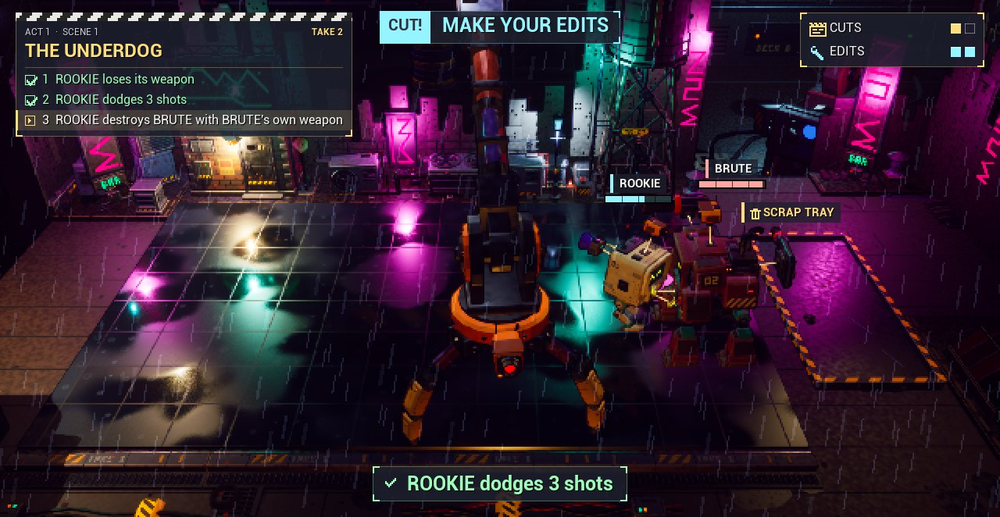
*Day 2, 19:35: the puzzle-film version during a CUT, as a reviewer agent saw it - script beats top left, the cuts and edits that are left top right, the director's arm over the set. Everything here was later replaced except the set, the machines and the CUT.*

**2. "Too plain" - one boss, one question (day 3 evening).** After playing the boss rush I wrote that it was only attack and dodge and that the bosses were too alike - they all either charge or shoot - and named Hades as a reference. The lead proposed six bosses that each ask one question with props on the floor, showed one picture per fight, and built fight 1 first as a sample. A reviewer agent read its square pillars as crates; they became round columns.

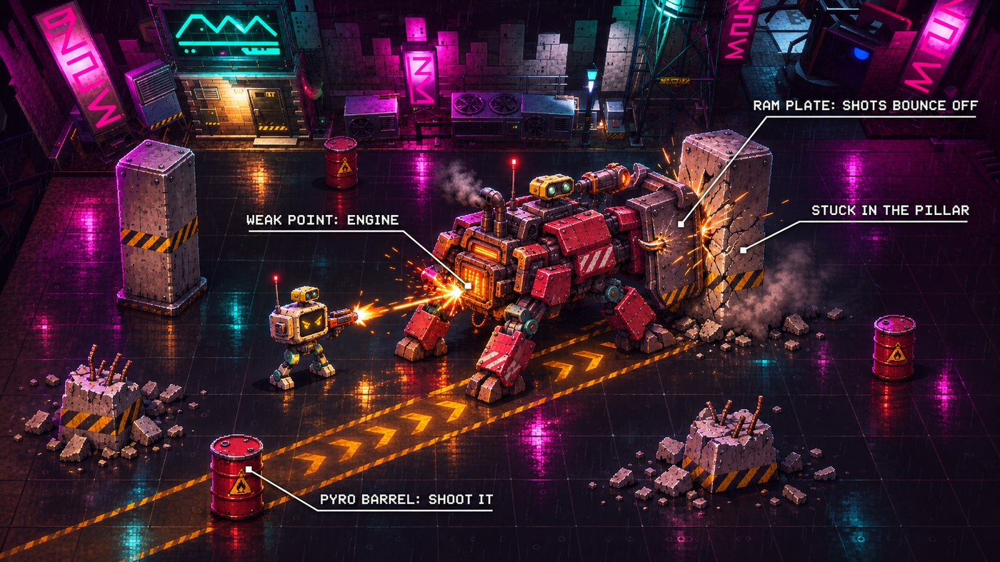
*Day 3, 19:23: concept for fight 1's question - bait BRUTE into a pillar, hit the engine on its back.*

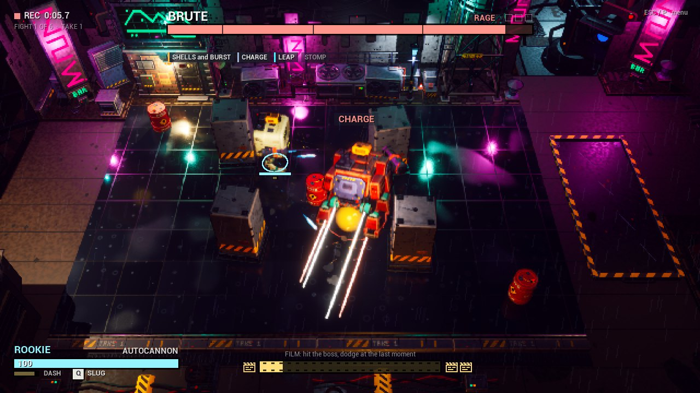
*Day 3, 19:58: the first playable sample, as a reviewer agent saw it. The square pillars read as crates.*

**3. Things that are light must look like light (day 4).** Fight 4's boss can only be hurt in light, and I said: the light is dark too. Every light had been cut to a fifth; the lead retuned them live. Then, of my hero's beam: it is a thick dark bar, and it has to light what is round it. It became a white-gold beam that casts real light.

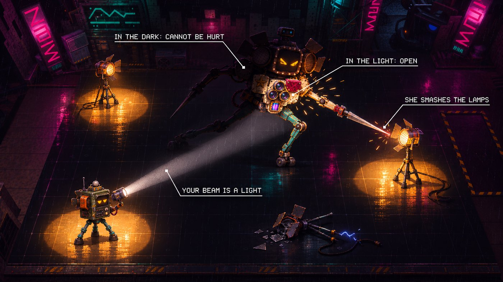
*Day 3: concept for fight 4 - in the dark she cannot be hurt.*

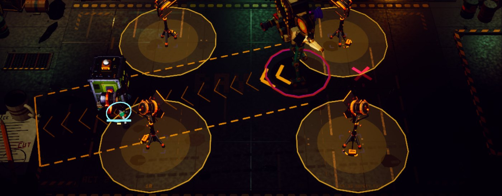
*Day 4, 14:21: before - the pools of light are as murky as the dark (cropped to the floor).*

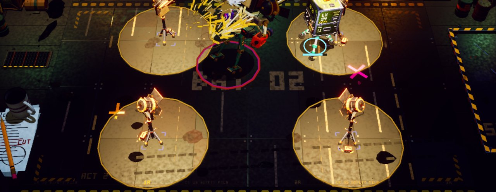
*Day 4, 14:28: after - stronger, gold pools; the "dark" got a cold light from above so shapes still read (cropped to the floor).*

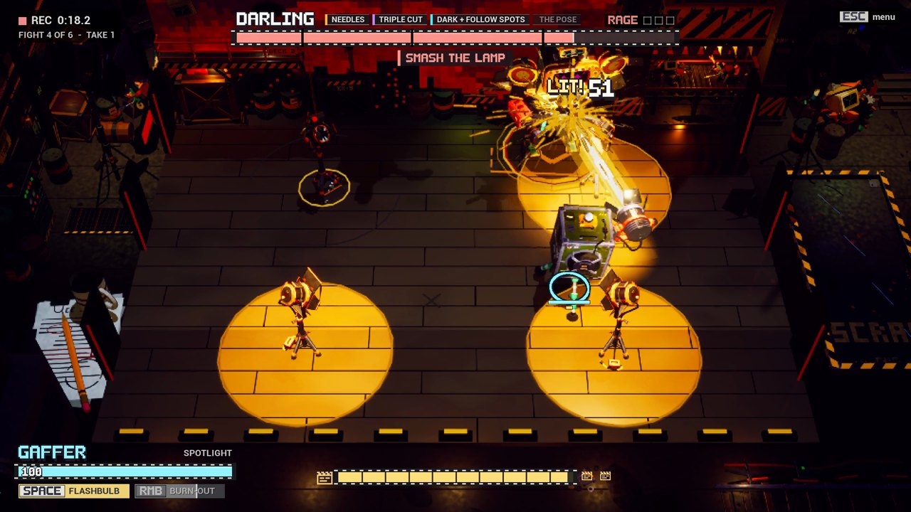
*The final build: the hero's beam as light - it lights the floor and the boss it crosses.*

**4. Picking a part must be easy.** The black-and-white "print" of the CUT looked right, but parts were hard to click from an odd view. Now the CUT moves to a view I can turn and zoom, and takeable parts stay in colour.

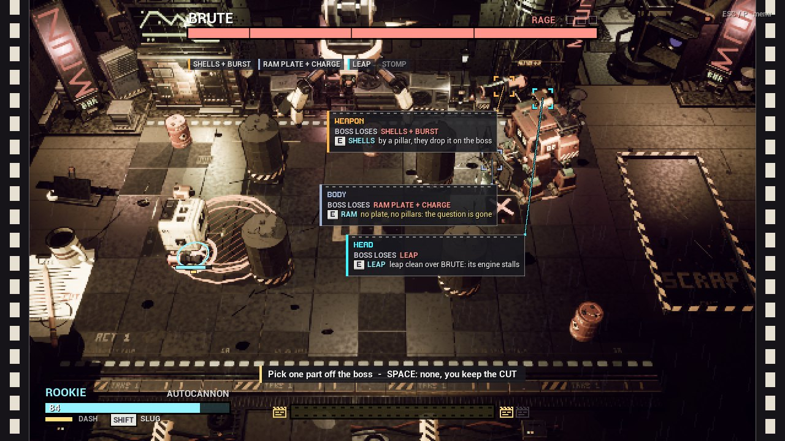
*Day 4, 15:14: the first CUT-as-a-print: the frozen frame desaturated, the part descriptions stacked over the boss.*

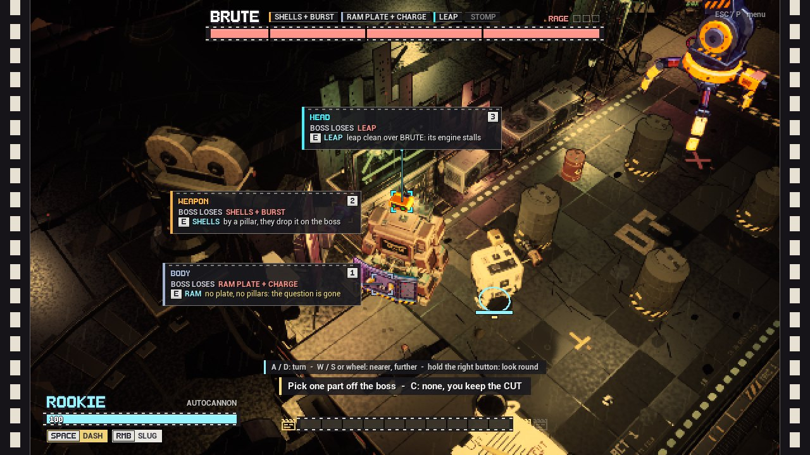
*Day 4, 16:38: after my note - a choosing view, parts in colour, tags with keys 1/2/3.*

**5. A block must look like a block (day 4, 19:05).** Of fight 3 I wrote that the guard was just a pose - put a shield in front so that it is clear - and asked for it to cover only the front and overhead. When the plan let a stopped boss pass through the shield, I objected: that is against common sense; a block should knock the enemy back a little. That went into the brief as a hard rule.

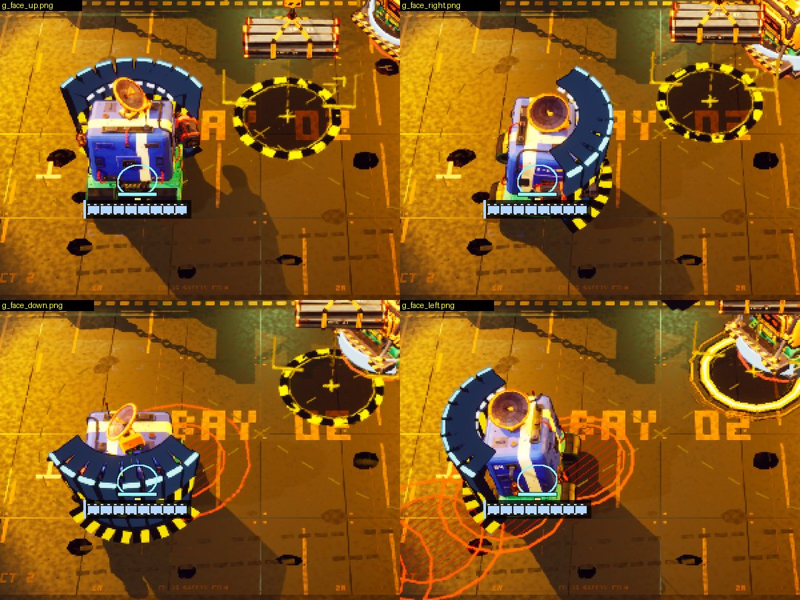
*Day 4, 21:21: the shield in four facings, drawn exactly as wide as the arc it covers.*

**6. Fight 5 as a duel, with a fallback agreed first - and the fallback taken.** I asked for fight 5 to become a Sekiro-style clash of blades; as it was, you only waited for the yellow shot. The lead called it the riskiest change - tells must read from above, and the machines have no hand animation - so we agreed a fallback before starting: if it really does not work, we take the conservative way. It was built in two stages with a report after the first.

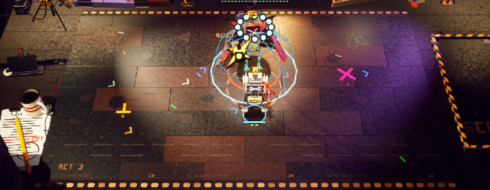
*Day 4, 20:52: the duel while it existed - boss and blade face to face (cropped to the floor).*

I played it at about 22:25 and turned it down: as a blade of light it did not look right, and the boss's weapon had been forced onto it, so we went back to the earlier scheme and changed that instead. Roughly four hours of agent work - the duel, its posture strip on the HUD, its entrance - came out again in one job. What went back in is the old shield fight with my two complaints answered inside it: every volley now carries gold shots and the blade's third cut on the shield draws one out, so there is nothing to wait for; a gold shot sent home is batted away to one side by the shield and has to be run down and cut home again, which puts out one of the shield's three lamps; and with its shield broken the boss fights back, shoots and lays mines instead of standing there as a dummy. The duel's files are kept in a backup folder.

**7. "Stop agreeing with everything."** After a day of the lead accepting every note, I told it to weigh my ideas objectively and to say so when one makes no sense. The first answer it gave under that rule: fight 2 had felt hard to me and I had blamed myself for not reading the instructions - but most players will not read the opening plate either, so the rule had to be visible in play. Fight 2 got a gold cue on the real take's first move.

**8. Every set looked the same.** Late on day 4 I said the arenas, the boss entrances and the title were too alike or too static, and the end reel slow (every part takes a long time, and it can only be skipped as a whole). Four jobs ran in parallel: a look per fight ("each fight is a scene from a different film"), six different entrances, a skippable reel, a title that moves.

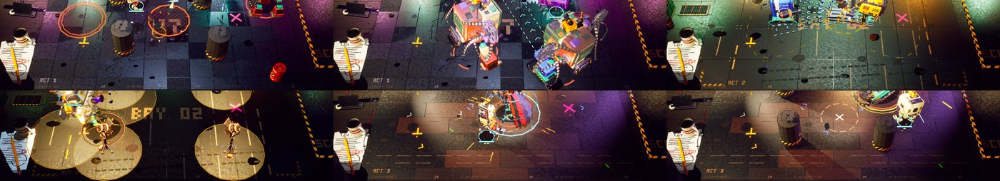
*Day 4, 19:46: all six fights before the per-fight looks (reduced, cropped to the floor).*

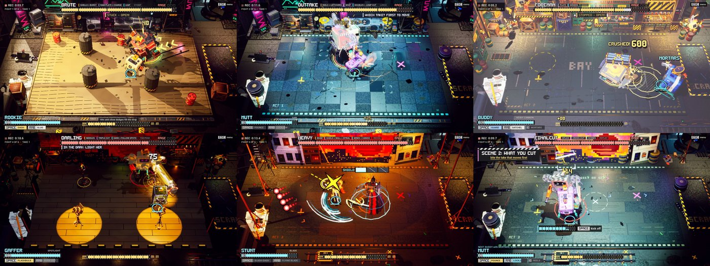
*The six fights in the final build. The first pass had made fight 3 one orange hue from floor to boss; the lead flagged it and it was redone.*

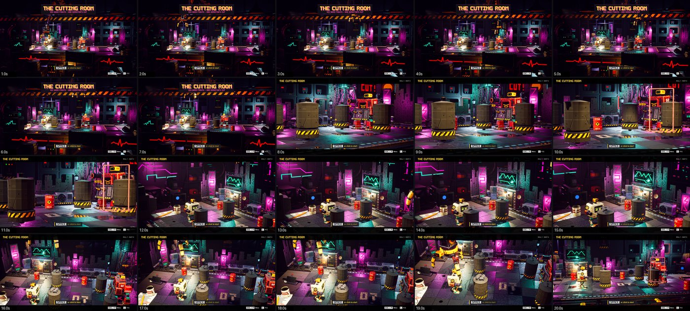
*Day 4, 20:13: contact sheet of the new title loop - a wide shot, then close shots of the set on the desk.*

## What went wrong

- **A merge that compiled nothing.** One merge copied files keeping their old timestamps; the build tool answered "Succeeded" in two seconds without compiling anything. Merged files are now always given a fresh time.
- **Every spot light was aimed wrong from day one.** Spawned spot lights were a quarter turn off, and the key lamp ignored its rotation entirely. Found on day 4; everything that had been tuned by eye before then (exposure, follow spots, "HEAVY is a black shape on the floor") had been tuned under the wrong light.
- **Guessing at causes.** Effects looked soft; bloom was the suspect, but on/off pictures were identical. What was done instead: every shot, beam and warning redrawn as hard flat shapes.
- **The stand-in is a far better player than me.** It aims better, almost every one of its clashes in the duel was "perfect" (in the fight that replaced the duel it misses fewer than 3 in 100 returns), and it parried 20-30 times a take in fight 3, so its numbers flatter. When fight 2 felt hard to me, the lead found that the bigger saw I had asked for also bit doubles standing beside the real target - something the stand-in never did - and narrowed it. Whether that was why the fight felt hard was never confirmed: the stand-in's data did not show it, and I had also skipped the instructions.
- **More violent is not better.** The lead asked for louder ride effects for MUTT's bite; my verdict was that the mechanic was good but the effects hid the machines. They were cut back to thin hard sparks and a LOCK sign.
- **Sounds nobody had heard.** Every sound was made and levelled by measurement, and for four days the log said that no one had listened to them. On the last morning I played the final build with the sound on, and it was fine.
- **Packaged too early.** On day 3 the lead packaged a Shipping build and sized a redesign to the deadline. I told it not to plan around the deadline again.
- **Out of graphics memory.** Four test games plus the editor filled the card; the editor hung once, and later was closed to free memory for the jobs. The engine allows one packaging run at a time, so packaging now queues.
- **Agents on a shared PC.** A simulated click meant for the editor once landed in another window I was using. Since then agents never touch the desktop; they use the windowless game and the editor's own capture.
- **Not verified when this was written** (day 4, about 21:30): BUDDY's "guard broken" state had never been seen in a picture; fight 6's BUDDY scene was untested; fight 3's orange look was being redone; blocked girders were still drawn across BUDDY; frame rate with the new looks was unmeasured. *[See "final hours" below.]*

## Numbers

Counted with tools on 15 November at about 21:30 local time, while jobs were still running:

| What | Count |
|---|---|
| C++ source files (`.cpp`/`.h`) | 51 files, 44,358 lines (47,598 in the submitted build, 16 November 07:47) |
| Blender Python scripts (models, sets, props, faces) | 25 files, 17,162 lines; 12 machine/arm scripts |
| Audio Python scripts | 10 files, 5,143 lines |
| Sounds in the game's audio folder | 97 WAV files (85 effects, 7 music, 2 ambience, 3 stings) |
| Harness scripts (`tools/*.ps1`, `*.py`) | 27 files, 1,995 lines |
| Written briefs for sub-agents (`*_SPEC.md`, `*_BRIEF.md`) | 21, plus 7 reviewer note files and a play-testers' manual |
| AI concept pictures | 70 |
| Play-test / job picture folders; pictures in them | 82 folders, 14,539 PNGs |
| Fights / heroes / bosses | 6 / 5 / 6 |
| Pre-merge backups of main | 29 (54 by 02:40 on 16 November) |

## If you want to work this way

- **Keep a log, and have it mark who decided what.** Ours separated what I had approved from what the lead had decided alone ("NOT seen by the owner"). That made it easy to overrule things, and to see that one of my sessions had been missed.
- **Never let a job edit the copy you play.** One copy per job, snapshots, three-way merges, a backup before every merge.
- **Give the agents eyes.** A windowless game they can drive line by line and a contact sheet of every stretch of play did more than any amount of log output.
- **Measure with a bot, but play it yourself.** The stand-in caught balance problems. It never caught what a person suffers.
- **Ask for pushback.** Agents agree too easily. After I said "tell me when I am wrong", the next answer told me a fight's rule could not be seen in play - which I had blamed on myself.
- **Agree the fallback before the risky rebuild.**
- **Decide by looking.** Most of my best notes came from a picture or a play session, not a design document.

## What changed in the final hours

*This part was written by the lead agent. I went to bed at about 23:20 on day 4, told it to keep raising the quality where it could be raised, and read this in the morning.*

**The night, 23:20 to the freeze at 03:40.** Seven job agents worked in their own copies of the project; five fresh reviewers and a tester played packaged builds. The lead merged 25 built snapshots into the main source, compiled after each, and ran every fight 24 times with the stand-in, and the whole game with its end reel, after every batch. A Shipping candidate was packaged for the owner to play in the morning; nothing was uploaded and nothing was submitted: that stayed the owner's.

- **Fresh eyes, three times.** Reviewers were started with no knowledge of the project: some were told to play it as someone who has ten minutes and has never seen it, one was forbidden to read the rule book. None of them could feel the controls, but the lists they brought back were concrete - where they waited, what they misread, which line they could not parse - and every job of the night came from those lists.
- **Nobody had ever heard the game, so it was measured.** The game can record its own mix without a speaker. Every fight clipped; the title was 7-10 LU quieter than the fights; the limiter on the master had never worked (its settings were overwritten when it was created). After: no clipping, all parts within about 1.5 LU, the CUT clap alone on its frame and 6 dB over what came before it. Whether it sounds good, no measurement can say.
- **Fight 1's first ten seconds.** The first reviewer spent them being shelled from across the floor while the hero's shots showed "1" on a 3500 bar. Now the boss charges first and rams a pillar at 3 s, armour-turned hits show a clank instead of a small number, and its back is marked while it is stuck. The same job found that the SPACE that started a fight had also been dashing the hero, in every fight, since the keys were changed the afternoon before.
- **Fight 5 again.** The rebuilt shield fight "played itself": stand still, hold the button. The shield now bats a returned shot wide, to a ring on the floor, and the blade must go and meet it. A sweep with slower stand-ins then showed it could barely be won at half speed (2 of 24) because of one attack; that attack was made a shove instead of a killer.
- **Fight 6.** Each scene that comes back now wears the set of its own fight, nothing else happens during a scene, and what the player scrapped comes back in a last act of its own. 148 s became about 90 s for the stand-in.
- **Words.** The first-time player could not parse five short lines. They were replaced, not lengthened. The part that removes a fight's trick is now labelled as what it is: the way round, and the longer one.
- **Cameras.** The win shot and the end reel's shots are now tested on what the frame will show, not on a line of sight; two of six reel shots had been unreadable.
- **The last hour.** A reviewer called fight 5 "the best fight I played, until the open window turned into a chase": the boss ran from a melee hero the moment its shield broke. It now stands and fights for three seconds first. The same reviewer pressed a number key from memory at a second CUT and would have taken the wrong part, because the parts were renumbered once one was gone; a part now keeps its number for the whole fight. One thing that was asked for was not done then: fight 4's pools of light were called overexposed, but the owner had asked for that fight to be brighter the afternoon before, so they stayed - until the owner looked again in the morning.
- **The release build.** The test harness is compiled out of a Shipping build, so no agent can play it. The most that could be done was to start it with no window and no sound and see that it was still running after fifty seconds.
- **The owner woke up early.** At about 04:40 the owner played the frozen build and left a few lines before going back to bed: the crane's girders must move at random again - attacking without a thought, the girder was over the enemy's head the whole time; the shield of fight 5 should take two returned shots a lamp, not three; the pools of light in fight 4 were overexposed after all; the gold cue of fight 2 was twice as heavy as it needed to be; and there was still time to make the fights better to play. So the freeze was lifted. A reviewer was sent to look for nothing but dead time, fight by fight, and found the same thing in three fights: between two openings the player's weapon is worth a quarter or a tenth, so the player waits. The fixes shortened the waits, not the openings: fight 2's takes move 0.6 s sooner, the boss of fight 4 takes her bow in a spotlight of her own, the girders of fight 3 have to be led to, and fight 5's shield breaks in six returns instead of nine to twelve.
- **The first freeze, measured (03:40).** Stand-in, 24 takes a fight: every fight won 24 of 24 at a 0.3 s and at a 0.6 s reaction; at 0.9 s fight 5 is won 18 of 24 and fight 6 19 of 24. The whole game ran through on first takes with no error line, and the six replays of the end reel matched their takes to the step. One game alone on the development PC's RTX 5080: 134-148 frames a second at 1920x1080, 113-126 at 2560x1440. Nothing was measured on a weaker machine.
- **The submitted build, measured (07:47).** After the morning's changes (31 merges since 23:20 in all): every fight is still won 24 of 24 by the stand-in at a 0.3 s and a 0.6 s reaction (28 / 43 / 58 / 56 / 55 / 79 s at 0.3); at 0.9 s fight 3 is won 21 of 24, fight 5 19 of 24, fight 6 22 of 24. Fight 3 took two more passes that morning. A reviewer still got the girders for nothing while holding fire, so the load was made to fall only on a boss held by the shield. The next reviewer did what the screen said, blocked in a place where the block did not count, and got nothing. The rule stayed; its reach and its hints were corrected, and the two stand-ins that never raise the shield - stand and fire, walk and fire - now get no load at all.

**What agents could not check:** the Shipping build cannot be driven by the test harness at all - an agent could only start it with no window and see that it kept running. Everything else in this section was played by agents and by the stand-in. The owner played the final build on the last morning, left fights 3 and 5 as they were, and took it to the upload.
